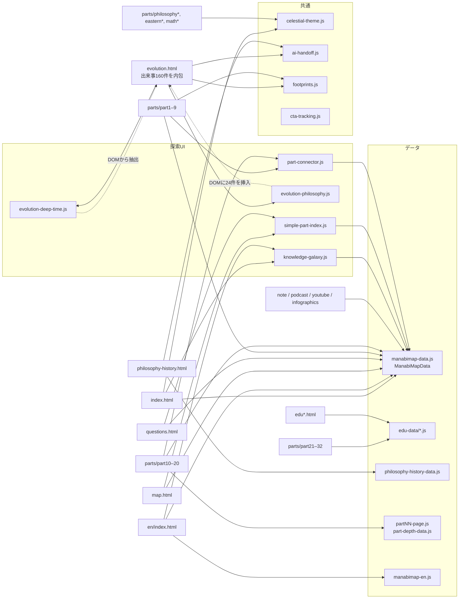

# 01. 現状調査 — 既存データの所在と依存関係

調査対象：`main` と同一のコミット `e3e6df2`（2026-11-14 時点、追跡ファイル671本）。
数値はすべてリポジトリの実ファイルを読み込んで数えたものです。

## 1. 全体像

- 静的サイト。`package.json`・ビルド設定・テスト・CI設定（`.github/`）は**存在しない**。
- JavaScript はすべて即時関数で、`window.*` のグローバルにデータを置く方式。読み込み順は各HTMLの `<script>` に依存。
- キャッシュ更新は `?v=20260923-1` のような手書きのクエリ文字列。
- 公開は GitHub Pages（`https://pinco53.github.io/ManabiMap/`）。

| 種別 | 本数 | 場所 |
|---|---|---|
| トップレベルHTML | 20 | `/` |
| 作品（部）ページ 日本語 | 44 | `parts/` |
| 作品ページ 英語 | 21 + 汎用1 | `en/parts/`, `en/part.html` |
| JavaScript | 45 + EDUデータ6 | `assets/js/`, `assets/js/edu-data/` |
| CSS | 24 | `assets/css/` |
| 年表画像 | 184 | `assets/images/evolution/`（うち curated 42、philosophy 24） |
| note画像 | 226 | `note_articles/generated_note_images/` |
| インフォグラフィック | 85 | `infographics/` |

## 2. データの所在

「どのデータが、どこに、どんな形で」あるかの一覧です。**データ台帳が5系統に分かれている**ことが最大の発見です。

| # | 台帳 | ファイル | グローバル | 中身 | 件数 |
|---|---|---|---|---|---|
| A | 本編の中核データ | `assets/js/manabimap-data.js`（292KB） | `ManabiMapData` | parts / concepts / notes / mediaItems / routes / questions | 21 / 10 / 226 / 407 / 6 / 5 |
| B | 138億年年表 | **`evolution.html` のDOM**（194KB） | なし（実行時にDOMから抽出） | 出来事 | 160（11時代区分） |
| B' | 年表の補助 | `assets/js/evolution-deep-time.js` | なし（ファイル内定数） | レンズ対応表 `EVENT_LENSES`、精選 `CURATED_ADDITIONS`、中核指定 | 160 / 42 / 48 |
| B'' | 年表の哲学レイヤー | `assets/js/evolution-philosophy.js` | なし | 哲学の転換点（日英） | 24 |
| C | 哲学史 | `assets/js/philosophy-history-data.js` | `MANABI_PHILOSOPHY_HISTORY` | 西洋10・東洋10・交差12 | 32 |
| D | EDU | `assets/js/edu-data/*.js` | `ManabiEduParts` ほか | 部12、研究カード60、人物50、エビデンス15、教育史51 | — |
| E | 哲学・東洋哲学・数学シリーズ | `parts/philosophy1–4.html` ほか**静的HTML** | なし | 各10話、人物、用語 | 8作品 |
| F | 作品ページ本文 | `assets/js/partNN-page.js`（10–20）、`part-depth-data.js` | `PartPageConfig`, `PartDepthData` | 導入・章・話・年表・前後の部 | 11作品 |
| G | 英語メタ | `assets/js/manabimap-en.js` ＋ `knowledge-galaxy.js` 内の対訳表 | `ManabiMapEnglish` | 21作品の題・問い | 21 |

`mediaItems` の内訳：note 226、podcast 172、youtube 9。

### 作品44本の内訳と台帳への登録状況

| シリーズ | 作品 | 本数 | 中核台帳Aに登録 | 銀河に表示 | 一覧への載り方 |
|---|---|---|---|---|---|
| ハルとおじいさん本編 | part1–20, part8_2 | 21 | ○ | ○ | `map.html` が台帳Aから自動生成 |
| 本編の分冊 | part9_1–3 | 3 | ×（part9に内包） | × | part9からのリンクのみ |
| EDU | part21–32 | 12 | ×（台帳Dに別管理） | × | `edu.html` が台帳Dから生成 |
| 哲学 | philosophy1–4 | 4 | × | × | `map.html` に**手書きカード** |
| 東洋哲学 | eastern1–2 | 2 | × | × | 同上 |
| 数学 | math1–2 | 2 | × | × | 同上 |

→ **44本中、銀河に見えているのは21本。20本（EDU 12＋哲学系 8）はシリーズとして存在するのに、探索UIからは見えない。**
`index.html` の canvas の `aria-label` も「21の学び」と固定で書かれています。

## 3. 依存関係

### ページ → スクリプト／データ

読み取れること：

- `manabimap-data.js` は **トップレベル7ページ＋本編21作品ページ＋英語トップ**から読まれる事実上の中心。ここを壊すと影響が最も広い。
- 年表は台帳Aに**一切依存していない**。逆に台帳Aも年表の出来事を知らない。両者をつなぐのは HTML 内の手書きリンクのみ。
- 哲学・数学シリーズのページは、データ台帳にも探索UIにも依存していない（＝完全に孤立）。
- `evolution-philosophy.js` は実行時に DOM へ出来事を挿入し、その後 `evolution-deep-time.js` が DOM を読む。**読み込み順に意味がある**暗黙の依存。

### 作品ページの4世代

同じ「部のページ」でも作り方が4通りあります。Atlasはこの違いを吸収する必要があります。

| 世代 | 対象 | 本文の持ち方 | 描画 |
|---|---|---|---|
| 1 | part1–9 | 45–64KBの静的HTML | `part-renewal.js` が装飾 |
| 2 | part10–20 | `partNN-page.js` の設定オブジェクト | `part-depth-renderer.js` ほか |
| 3 | part21–32（EDU） | `edu-parts.js` のデータ | `part-edu-renderer.js`（HTMLは1.2KBの殻） |
| 4 | 哲学・東洋哲学・数学 | 31–35KBの静的HTML | `philosophy-part.css` のみ |

## 4. 3つの軸の実態

### 4.1 時間

| 場所 | 時間の表現 | 機械可読か |
|---|---|---|
| 作品（台帳A）`era` | 「18世紀後半から」「火の獲得から核融合へ」 | ×（自由文） |
| 年表の出来事 | 「約136億年前」「紀元前2600年頃」「11〜15世紀」 | △（`ageFromDate()` が正規表現で都度解釈） |
| 哲学史（台帳C）`date` | 「紀元前5〜4世紀」 | △（同上の解釈が必要） |
| EDU教育史 `year` | `1763`〜`2024` の数値 | ○ |
| EDU研究カード `year` | 数値 | ○ |
| 哲学シリーズ | 「ソシュール（1857–1913）」とHTMLに記載 | × |

- 年表の位置は `logPosition(age) = 0.88 × (1 − log10(1+age) / log10(1+138億))`。138億年から現在までを1本の対数軸に載せる、よくできた仕組みです。**そのまま全シリーズ共通の時間軸として使えます。**
- ただし基準年 `PRESENT = 2026` がコードに固定されています。
- 出来事160件のうち、固有の `id` 属性を持つのは精選の42件のみ。残り118件は「上から何番目か」（`event-37` など）で識別されており、**出来事を1件挿入すると以降の番号と画像対応がずれる**構造です。
- レンズ分類 `EVENT_LENSES` は日本語タイトルの完全一致がキー。タイトルを直すと分類が外れます。

### 4.2 概念

- 作品が持つ `concepts` のスラッグは延べ73種。`ManabiMapData.concepts` に定義があるのは **10種**（63種は名前も説明も無い文字列）。
- 複数作品で共有されているスラッグは `generative-ai`（3作品）、`metacognition`（3作品）、`attention-economy`、`education` など少数。
- タグは101種あり、複数作品で共有されるのは8種（AI:8作品、教育:3 ほか）。**タグでは作品同士がほとんどつながらない。**
- 銀河のレンズ所属は、題・副題・タグ・問いを連結した文字列への**正規表現マッチ**で実行時に決めています（例：`/AI|人間|思考|判断|感性|…/` → `thinking`）。新シリーズの語彙が増えると誤分類が増えます。

### 4.3 問い

問いはサイトの中心概念ですが、**IDを持たない文字列として7か所に分散**しています。

| 場所 | 件数 |
|---|---|
| 台帳A `questions`（サイト全体の問い） | 5 |
| 台帳A 各作品の `questions` | 42（21作品×2） |
| 台帳A 各 note／media の `question` | 407（多くは作品の問いの複製） |
| 銀河のレンズの問い | 6 |
| 年表のレンズの問い | 10 |
| 年表の哲学レイヤー `questionJa` | 24 |
| 哲学史 `question` | 32 |
| EDU `centerQuestion` / `parentQuestion` | 12 + 話ごと |

同じ問いが別の言い回しで複数箇所に現れても、それらが「同じ問い」であることはデータ上わかりません。

## 5. シリーズ間接続の実態

現在ある「つなぎ」をすべて挙げます。

| 接続 | 定義場所 | 範囲 | 性質 |
|---|---|---|---|
| `next`（各作品3件） | 台帳A | 本編内。`evolution`・`note` という**台帳に無い擬似ID**を6か所で参照 | 理由の記載なし |
| `routes`（6本） | 台帳A | 本編＋note | 5ノード前後の順路 |
| `concepts[].related` | 台帳A | 本編内 | 作品側の `concepts` と二重管理 |
| `prev` / `next` / `arcHtml` | `partNN-page.js` | part10–20 | 手書き文。台帳Aの `next` と独立 |
| 「学びの地図の現在地」パネル | `part-connector.js` | 本編 | 台帳Aから生成（問い・動画・Podcast・note・次の部） |
| 年表 → 作品 | `evolution.html` の `event-link` | 出来事から12作品へ計49リンク（ほかにページ末尾の一覧ボタン17個） | 片方向。作品から出来事へは戻れない |
| 教育史 → 本編 | `edu-history.js` の `bridges`（3件）、`relatedHumanParts`（51件中10件） | EDU → part1–3 ほか | 片方向 |
| 研究カード → 部 | `edu-cards.js` `relatedParts`（60件中52件） | EDU内 | — |
| 哲学シリーズ内 | 各HTML | 哲学・東洋哲学・数学の相互と `philosophy-history.html` | 手書きリンク |
| 数学 → 本編 | `math1.html`、`math2.html` | 第8部・第14部へ計3リンク | 手書きリンク。データなし・片方向 |
| 年表の哲学レイヤー | `evolution-philosophy.js` | 年表内 | 既存出来事の**日本語タイトル**を挿入位置の目印にする |

**無いもの：**

- 哲学・東洋哲学 ↔ 本編 の接続（例：ソシュール ↔ 第5部「言葉と思考の旅」）。数学 → 本編は手書きリンクが3本あるのみ
- EDU ↔ 本編 の作品単位の接続（例：第30部「ヒトだけの学び方」↔ 第13部「学びとは何か」）
- 作品 → 年表の出来事 への接続
- 接続の「理由」（なぜこの2つがつながるのか）

## 6. 探索UIの実態

### 銀河（`index.html` ＋ `knowledge-galaxy.js` 23KB）

- 2枚の canvas：背景の星（WebGL、PC 80万点／モバイル40万点）と、前景の場（Canvas 2D）。
- 前景：作品21個のアンカー星＋メディア件数ぶんの塵（407個）。塵は `index % 作品数` で作品に割り当て（実際の所属ではない）。
- 操作：レンズ6種の切替、深さスライダー 0–100（ホイール連動）、クリックで作品カード、「問いに連れていって」（ランダム）。
- 深さスライダーの表示は「全体を眺める → 部のあいだを歩く → 一つの問いへ潜る」の3段階。ただし現状は**拡大率が変わるだけ**で、見える情報の種類は変わりません。
- **キーボード操作なし**（`keydown`・`tabindex` が0件）。作品の星はcanvas上の絵で、支援技術からは見えません。
- 状態はURLに残りません（共有・戻るボタン不可）。

### 138億年年表（`evolution.html` ＋ `evolution-deep-time.js` 64KB）

- 対数時間軸、ズーム最大48倍、表示範囲2種（中核／すべて）、レンズ10種＋すべて。
- 出来事は `<button>` として生成されるため、こちらは**キーボードで到達可能**。
- 選んだレンズに応じたAI対話文を作り、`ai-handoff.js` で ChatGPT / Claude / Gemini / Copilot に渡せる。
- 英語版 `en/evolution.html` は同じ160件を別HTMLとして複製。

### その他の再利用できる部品

| 部品 | 内容 | Atlasでの使い道 |
|---|---|---|
| `footprints.js` | 訪れた作品を localStorage に記録（サーバー送信なし） | 「歩いた道」の表示 |
| `ai-handoff.js` | 対話文をコピーして好みのAIを開く | 選択中の問い・経路からの対話 |
| `celestial-theme.js` / `tokens.css` | 配色・和色名（檜皮・琥珀・柳…） | シリーズと作品の色 |
| `part-sigils.js` | 作品ごとの星座SVG（14作品分） | 作品ノードの図像 |
| `sky-clock.js` | 端末時刻で空の色調が変わる | 雰囲気の継承 |
| `cta-tracking.js` | `data-track-*` 属性でGA4に送信 | 横断遷移の計測 |

## 7. 課題のまとめ

| # | 課題 | 影響 | 対応する設計 |
|---|---|---|---|
| 1 | 台帳が5系統に分裂し、20作品が探索UIの外 | 新シリーズを足すたびに孤立が増える | [04](04-information-architecture.md) 統合グラフ |
| 2 | 概念の辞書が無い（63/73が未定義） | 概念で横断できない | 04 概念辞書 |
| 3 | 問いにIDが無く7か所に分散 | 「同じ問い」で束ねられない | 04 問い台帳 |
| 4 | 時間が文字列。出来事はDOMの中、識別は順番 | 他シリーズを時間軸に載せられない。挿入で番号がずれる | 04 時間モデル |
| 5 | 接続が片方向・理由なし・擬似IDあり | 「なぜつながるか」が伝わらない | 04 エッジ仕様 |
| 6 | レンズが銀河5種と年表10種で別体系、所属は正規表現 | 軸をまたぐと切り口が途切れる | 04 レンズ統合 |
| 7 | 銀河がキーボード・支援技術で使えない。状態がURLに残らない | 探索の共有・再訪ができない | [05](05-exploration-ui.md) |
| 8 | 対訳が複数ファイルに散在（銀河JS内にも直書き） | 多言語化が作品数に比例して重くなる | 04 多言語フィールド |
| 9 | 検証の仕組みが無い | 参照切れに気づけない | [07](07-validation.md) |
| 10 | 作品ページが4世代 | 統一改修は高コスト | [06](06-technical-design.md) で「触らず包む」方針 |

> **追記（フェーズ1の取り込み後）**：上記の数値のうち、年表→作品のリンク数（当初「17作品へ66リンク」と記載）と、数学→本編の手書きリンクの存在は、
> 取り込みスクリプトで実測して訂正しました。最新の実測値は [reports/atlas-report.md](reports/atlas-report.md) にあります。

## 8. 生かすべき資産

課題と同じくらい重要なので明記します。

- **コンセプトの一貫性**：「知の重力レンズ」＝点（知識）が、焦点（問い）に引き寄せられる。次世代構想はこの延長線上にあります。
- **年表の対数軸と160＋24件の出来事**（画像184枚、作品への49リンクと外部出典リンクつき）。
- **本編の構造化済みデータ**：21作品、note 226、Podcast 172 が作品に紐づけ済み。
- **EDUの高品質な構造化データ**：研究カードに確からしさ（`certainty`）と出典、人物50人。
- **哲学史32項目**：問い・地域・出典つき。
- **個人情報を送らない設計**、**好みのAIに渡す導線**、**和色のデザイン言語**。
