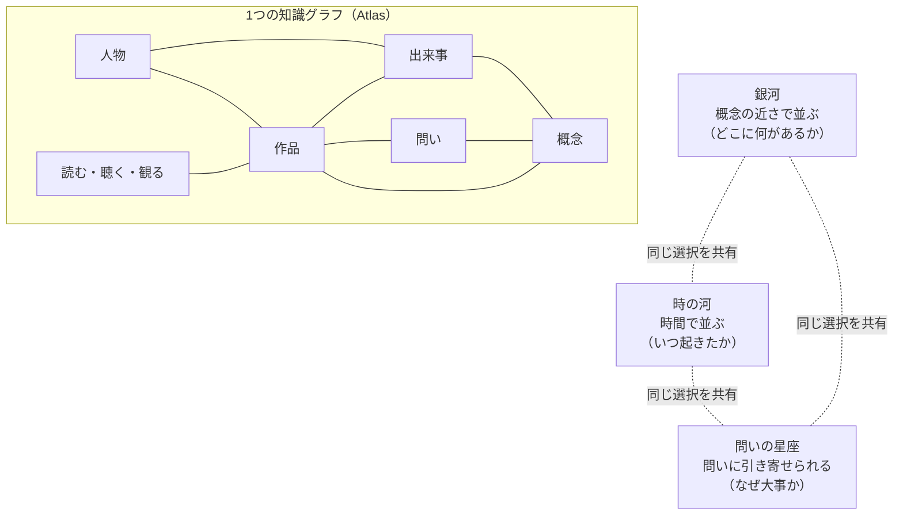

# 02. 全体構想

## 1. 一文で

**「どの作品から入っても、時間・概念・問いのどれかを手がかりに、別のシリーズへ歩いて行ける知の世界」** を作る。

## 2. いま起きていること、これから起きること

現在は「本編21作品の銀河」と「138億年の年表」が別々の入口として並び、哲学・数学・EDU はその外側にあります。
シリーズが科学・世界の物語…と増えると、このままでは次のようになります。

- 一覧ページにカードが増え続け、**全体像が「長いリスト」になる**。
- 各シリーズが内部では充実しても、**隣のシリーズへ渡る橋が無い**。
- 同じ人物・同じ出来事・同じ問いが複数シリーズに別々に現れ、**出会い直しの機会を逃す**。

ManabiMap の独自性は「知識の量」ではなく「知識のつながり方」にあります（README の言葉では *個別に覚えるのではなく、つながりから世界を探究する*）。
したがって次世代の中心課題は、**シリーズが増えるほど世界が豊かに見える構造**を先に用意することです。

## 3. 世界の見取り図

1つの知識グラフを、3つの見え方で見せます。どれも同じものを別の角度から見ているだけ、というのが要点です。

| ビュー | 並べ方 | 答える問い | 元になる既存資産 |
|---|---|---|---|
| **銀河** | 概念の近さ・シリーズ | 「全体はどうなっている？ 近くに何がある？」 | トップの銀河UI |
| **時の河** | 138億年の対数時間 | 「これはいつのこと？ 同じ頃に何があった？」 | 138億年年表 |
| **問いの星座** | 問いへの関わりの強さ | 「この問いに、誰が・いつ・どう答えようとした？」 | 銀河のレンズ、年表のレンズ |

例：第5部「言葉と思考の旅」を選んだまま——

- **銀河**では、隣に哲学シリーズ第1部（ソシュール）と第8部（AIと人間のあいだ）が見える。
- **時の河**に切り替えると、言語の起源から AI 言語処理までの帯の上に、ソシュール（1857–1913）と生成AIの登場が並ぶ。
- **問いの星座**に切り替えると、「言葉は思考を作るのか、思考が言葉を作るのか」を中心に、荘子・ソシュール・LLM が同じ引力圏に入る。

## 4. 体験の原則

| # | 原則 | 具体的には |
|---|---|---|
| 1 | **問いが重力** | 何かを選ぶと必ず「問い」が出る。線ではなく問いが人を次へ運ぶ。現行コンセプト「知の重力レンズ」の継承 |
| 2 | **つながりには理由がある** | すべての横断接続に一文の理由。「関連あり」とだけ書かれた線は置かない |
| 3 | **選択は持ち運べる** | ビューを切り替えても選んだものは変わらない。URLで共有・再訪できる |
| 4 | **迷っても帰れる** | 常に「いまどこ」「どこから来たか」が見える。足あとは端末内にだけ残る |
| 5 | **眺めるだけでも成立する** | 操作しなくても美しく、意味が読める。操作は深めたい人のため |
| 6 | **誰でも使える** | canvas の裏に同じ内容のリストを持ち、キーボード・読み上げ・動きを減らす設定で同じ探索ができる |
| 7 | **AIは出口であり相棒** | 選んだ問い・経路から対話文を作り、好みのAIへ渡す（現行の導線を拡張） |
| 8 | **増やすのは一か所** | 新シリーズはデータを足すだけで3つのビューすべてに現れる |

## 5. 想定する使われ方

| 人 | きっかけ | Atlasでの動き |
|---|---|---|
| 初めて来た中高生 | SNSで見た1本の動画 | 作品ページ → 「同じ問いの別の答え」→ 別シリーズの1話へ |
| 学び直しの社会人 | 「AIと教育」が気になる | 問いの星座で問いを選ぶ → 本編・EDU・哲学が同じ画面に集まる |
| 保護者・教員 | EDUシリーズの読者 | EDU第30部 → 「ヒトだけの学び方」の進化的背景として本編第13部・年表へ |
| 探究学習の授業 | テーマ設定 | 時の河で時代を絞る → 出来事と作品を選ぶ → 経路をURLで配布 |
| 常連 | 新作が出た | 銀河で新しい星が灯る → 既読の星との間に線が引かれている |

## 6. やらないこと

範囲を明確にするため、今回の構想に**含めない**ものを挙げます。

- 既存の作品ページ本文の書き直し・統一テンプレート化。
- ログイン、サーバー側の利用履歴保存、ランキング、進捗バー（現行の「数値もバーも出さない」方針を維持）。
- サイト内で動くAIチャット（外部AIへの受け渡しを継続）。
- 3D空間を自由に飛び回る操作（[03](03-options.md) の案Cで検討のうえ見送り）。
- 概念の自動抽出・接続の自動生成を**そのまま公開すること**（候補出しには使うが、公開は人の確認後）。

## 7. 成功の定義

詳細な指標は [07](07-validation.md) に置きます。構想レベルでは次の3つです。

1. **見える**：全シリーズの全作品が、3つのビューのいずれからも到達できる。
2. **渡れる**：任意の作品から、理由つきの接続を2回たどる以内に、別シリーズの作品へ行ける。
3. **増やせる**：新シリーズ1本（作品2〜4本）の追加が、データ追記と検証だけで完了する。
