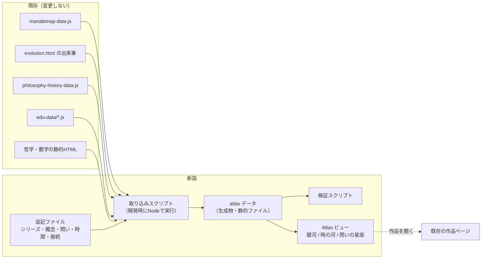

# 03. 案の比較と推奨

3案を比較します。評価軸は「目的を達成できるか」「既存資産をどれだけ生かせるか」「運用を続けられるか」です。

## 案A：現行延長（台帳への追記で対応）

**やること**：`manabimap-data.js` の `parts` に哲学・数学・EDU を追記し、銀河に星を増やす。年表の出来事に作品リンクを足す。`map.html` の手書きカードを自動生成に寄せる。

| | |
|---|---|
| 良い点 | 最短。新しい仕組みが要らない。今の見た目のまま星が増える |
| 困る点 | `parts` は本編用の形（`number` `colorName` `next` 3件…）で、他シリーズに合わない。概念・問い・時間の課題（[01](01-current-state.md) の課題2〜6）が**そのまま残る**。銀河のレンズ判定は正規表現のままなので、語彙が増えるほど誤分類が増える。年表は相変わらずHTMLの中 |
| 本番への影響 | **初日から** `manabimap-data.js`（7ページ＋21作品ページが依存）と `knowledge-galaxy.js` を編集する |
| 行き着く先 | 作品50〜60本あたりで銀河が読めなくなり、結局は構造の見直しが必要になる |

## 案B：知の地図帳（Atlas）— 統合グラフ層を足す　★推奨

**やること**：既存の台帳には手を触れず、それらを読み取って1つの知識グラフにまとめる層を**新設**する。不足分（シリーズ台帳・概念辞書・問い台帳・時間の数値・接続の理由）だけを新しいファイルに書く。
そのグラフを、銀河／時の河／問いの星座の3ビューで見せる新ページを作り、検証できてから既存の銀河・年表・作品ページを順にグラフへつなぎ替える。

| | |
|---|---|
| 良い点 | 既存ページを壊さずに始められる。課題1〜9に正面から対応する。新シリーズは追記ファイルに足すだけ。フェーズごとに止められる（データだけ整えて終わっても、検証と一覧生成の価値が残る） |
| 困る点 | 移行期間中は「既存の台帳」と「追記ファイル」の2か所を見る必要がある。開発時に Node を使う（サイト自体は今まで通りビルド無しで動く）。接続の理由を書く編集作業が発生する |
| 本番への影響 | フェーズ1〜2は**新規ファイルの追加のみ**。既存ファイルの編集はフェーズ3から、1ページずつ |
| 行き着く先 | 作品200本・出来事1,000件規模まで同じ構造で持ちこたえる（[06](06-technical-design.md) の性能設計） |

## 案C：全面再構築（3D宇宙のシングルページアプリ）

**やること**：フレームワーク＋3D描画ライブラリで、宇宙空間を自由に飛ぶ1つのアプリとして全体を作り直す。作品ページもアプリ内で表示。データはCMSまたはデータベースへ。

| | |
|---|---|
| 良い点 | 没入感は最大。データ構造を理想形から設計できる |
| 困る点 | 既存の44作品ページ・24のCSS・45のJSの大半が**作り直し**になる。ビルド工程・依存ライブラリの保守が恒常的に必要になる。検索エンジン向けの静的ページ、URL、軽さ、低スペック端末対応を失いやすい。3D空間は「迷う」「戻れない」「文字が読みにくい」という学習UI上の弱点がある。公開までの期間が長く、その間シリーズ追加が止まる |
| 本番への影響 | 全面置き換え |
| 行き着く先 | 見た目は最も新しいが、ManabiMapの価値である「読む・聴く・考える」の本文体験に投資が回らない |

## 比較表

5点満点（5が最良）。重みは目的への寄与度で付けています。

| 評価軸 | 重み | 案A 現行延長 | 案B Atlas | 案C 全面再構築 |
|---|---|---|---|---|
| 時間・概念・問いでの相互接続 | ×3 | 1 | 5 | 5 |
| 既存資産の活用 | ×3 | 4 | 5 | 1 |
| シリーズ追加の容易さ | ×2 | 2 | 5 | 4 |
| 自由な操作・探索 | ×2 | 2 | 4 | 5 |
| 本番への安全性（壊さない） | ×2 | 2 | 5 | 1 |
| 運用の軽さ（ビルド無し・少人数） | ×2 | 5 | 4 | 1 |
| 表示の軽さ・端末対応 | ×1 | 4 | 4 | 2 |
| 使いやすさ（キーボード・読み上げ） | ×1 | 2 | 5 | 2 |
| 最初の成果が出るまでの早さ | ×1 | 5 | 4 | 1 |
| **加重合計（85点満点）** | | **48** | **79** | **45** |

点数は判断を整理するための目安で、厳密な測定ではありません。ただし案Bが首位である点は、重みを多少変えても変わりません
（案Aは「接続」で、案Cは「既存資産」「安全性」「運用」で大きく失点するため）。

## 推奨：案B

### 理由

1. **問題の所在がデータにあるから。** 現状調査の課題10件のうち8件はデータ構造の問題で、見た目の問題ではありません。案Aはそこに触れず、案Cは見た目ごと作り直します。案Bだけが問題の場所に直接効きます。
2. **既存の設計思想がそのまま使えるから。** 銀河の「レンズ＝問い」、深さスライダーの3段階、年表の対数軸とレンズは、3ビュー構想の原型です。案Bはこれらを「同じグラフの別の見え方」として位置づけ直すだけで済みます。
3. **引き返せるから。** フェーズ1（データの土台）で止めても、参照切れの検出・一覧の自動生成・接続の棚卸しという成果が残ります。案Cは完成するまで価値が出ません。
4. **本番を守れるから。** 既存ファイルに触るのは、新ビューで検証が済んだ後、1ページずつです。

### 案Bに取り込む他案の良い点

- **案Aから**：最初の本番反映は「銀河に20作品を足す」という小さく分かりやすい変更にする（フェーズ3）。
- **案Cから**：奥行き・光・動きの表現は、既存のWebGL星空の上に段階的に足す。ただし操作は2D＋ズームにとどめ、3D飛行はしない。

### 案Bのリスクと手当て

| リスク | 手当て |
|---|---|
| 台帳が二重になる期間が長引く | 取り込みスクリプトが既存台帳を**読むだけ**にし、同じ情報を追記ファイルに書かせない。検証で重複を検出 |
| 接続の理由を書く作業が重い | 最初は作品間の横断接続40〜60本に絞る。候補は自動で出し、採否と一文だけ人が決める |
| グラフが「線だらけ」になり読めない | 画面に同時に出す線の上限を決める（[05](05-exploration-ui.md)）。既定では選択中のノードの接続だけ表示 |
| 新ビューが既存の銀河と別物に見える | 既存の canvas・配色・文言を流用し、まず同じ見た目で作品数だけ増やす |
