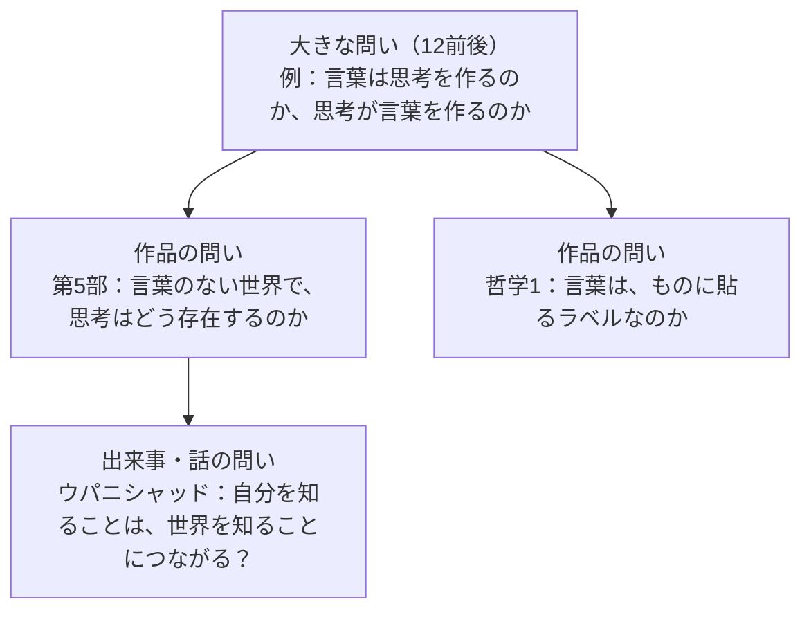

# 04. 情報構造

すべてを **ノード（もの）** と **エッジ（つながり）** で表す1つのグラフにまとめます。
ここで決めるのは「何をどういう形で持つか」で、ファイルの置き場所や生成方法は [06](06-technical-design.md) で扱います。

## 1. ノードの種類

| 種類 | ID接頭辞 | 意味 | 初期件数（既存から） | 主な出どころ |
|---|---|---|---|---|
| シリーズ | `series:` | 作品のまとまり | 公開中5＋構想5 | **新規に定義** |
| 作品 | `work:` | 1本の部 | 41 | 台帳A 21＋EDU 12＋哲学系 8 |
| 話 | `ep:` | 作品内のエピソード | 数百（未集計） | 各作品のデータ／HTML |
| 出来事 | `event:` | 年表上の点・区間 | 267 | 年表160＋哲学24＋哲学史32＋教育史51 |
| 概念 | `concept:` | 再登場する考え方 | 約80〜120 | 既存スラッグ73を整理＋**新規に定義** |
| 問い | `q:` | 引き寄せる中心 | 大きな問い12前後＋作品の問い約70 | 分散している問いを集約 |
| 人物 | `person:` | 思想家・研究者・発明者 | 約80（概算） | EDU人物50＋哲学シリーズ＋年表 |
| メディア | `media:` | note・Podcast・動画 | 407 | 台帳A |
| 研究 | `study:` | 研究カード・エビデンス | 75 | EDU 60＋15 |
| 道 | `route:` | おすすめの順路 | 6＋ | 台帳A |
| レンズ | `lens:` | 見る切り口 | 12前後 | 銀河5＋年表10を統合 |

出来事の件数は重複整理前の合計です（例：年表の哲学レイヤーの「孔子」と哲学史の「孔子」は1つにまとめる候補）。

### シリーズの初期定義

**決定済み（2026-11-15）**：各シリーズは別シリーズとして同じ銀河に同居させる。哲学は「西洋哲学」と「東洋哲学」の2シリーズを持つ。

| ID | 名称 | 系統（family） | 作品 | 状態 |
|---|---|---|---|---|
| `series:human` | ハルとおじいさん（人類史とAI） | — | part1–20, part8-2 | 公開中 |
| `series:edu` | EDU（学びと子ども） | — | part21–32 | 公開中 |
| `series:philosophy-west` | 西洋哲学 | `family:philosophy` | philosophy1–4 | 公開中 |
| `series:philosophy-east` | 東洋哲学 | `family:philosophy` | eastern1–2 | 公開中 |
| `series:math` | 数学 | — | math1–2 | 公開中 |
| `series:science` | 科学 | `family:science`（仮） | — | 構想 |
| `series:cosmos` | 宇宙 | `family:science`（仮） | — | 構想 |
| `series:physics` | 物理 | `family:science`（仮） | — | 構想 |
| `series:life` | 生命 | `family:science`（仮） | — | 構想 |
| `series:ai-origins` | AIの源流 | — | — | 構想 |

- 構想中のシリーズのIDと系統は仮置きです。実際に作品ができた時点で確定します。
- 本編の既存の `group`（三大革命、文明の道具…9種）は、シリーズ内の小分類 `cluster` として保持します。

### シリーズが雑多に広がる前提での決まり

今後のシリーズは、作者の興味に応じて予告なく増え、分野も揃わない前提で設計します。
「あらかじめ全体の分類表を作り、空き枠を用意しておく」方式は採りません。

| 決まり | 理由 |
|---|---|
| **シリーズは軽い札にすぎない。** 必須項目は名称・色・一言の説明だけ | 新しい興味が生まれたその日に足せるようにする |
| **系統（family）は任意。** 付けると銀河で近くに置かれ、一覧でまとまる。付けなくてよい | 西洋哲学と東洋哲学のような「近い別物」を表す。分類の正しさを議論しなくて済む |
| **作品が1本でもシリーズにできる。** シリーズに属さない単発の作品（はぐれ星）も許す | 「まだ1本しかないから載せられない」をなくす |
| **つながりはシリーズではなく、概念・問い・時間が作る** | 雑多でも世界がばらばらにならない理由はここにある。シリーズが何であれ、同じ問いを持てば同じ引力圏に入る |
| **銀河での位置は、既存作品との近さから自動で決まる**（[06](06-technical-design.md) 5章） | 分野が予測できないので、置き場所を先に決められない |
| **シリーズの分割・統合・改名ができる。** 作品のIDはシリーズ名を含まない | 「科学」が育って「宇宙」「物理」に分かれる、といった変化に耐える |
| **新しい作品は、既存作品への橋を最低1本、理由つきで持つ**（シリーズの最初の作品は3本） | 雑多に増えるほど、孤立した星を作らないことが重要になる |

想定される重なりの例：「宇宙」は年表の宇宙・生命の時代（ビッグバン〜地球誕生）と、「生命」は第9部「身体という時間」や年表の進化の出来事と、
「AIの源流」は第7部（チューリング、フォン・ノイマン）・第8部・数学2（確率統計）・西洋哲学と、最初から多くの接点を持ちます。

## 2. IDの決まり

- 形式は `種類:スラッグ`。スラッグは英小文字・数字・ハイフン。例：`work:part17`、`concept:external-memory`、`q:language-and-thought`。
- **一度公開したIDは変えない。** 題名や順番が変わってもIDは不変（現状の年表は順番で識別しているため、ここが最重要の改善点）。
- 既存IDはそのまま使う：`part8-2`（ファイル名は `part8_2.html`）のようなずれは、IDを正とし、URLは別フィールドに持つ。
- 旧来の呼び名は `aliases` に残す（例：`event:printing-press` の aliases に `deep-event-52`）。
- 擬似ID `evolution` `note`（台帳Aの `next` が6か所で参照）は、`page:evolution` `page:note` という正式なノードにする。

## 3. 共通フィールド

```jsonc
{
  "id": "work:part17",
  "type": "work",
  "title":    { "ja": "交換と協働", "en": "Exchange and Cooperation" },
  "summary":  { "ja": "なぜ人類だけが、見知らぬ他人と協力できたのか" },
  "url":      { "ja": "parts/part17.html", "en": "en/parts/part17.html" },
  "series": "series:human",
  "cluster": "文明と未来",
  "time": [ { "start": -50000, "end": 2026, "precision": "era", "label": { "ja": "贈与からAI時代へ" } } ],
  "lenses": ["lens:cooperation", "lens:value"],
  "color": "part17",
  "status": "published",
  "source": { "from": "manabimap-data.js#parts", "id": "part17" }
}
```

（`time` の数値は形式を示すための例で、確定値ではありません。）

- **多言語**：表示文字列は `{ja, en}`。英語が無ければ日本語で代替表示し、検証で「未翻訳」として数える（現状は対訳が3ファイルに散在）。
- **`source`**：そのノードが既存のどの台帳から来たかを必ず記録。二重管理の検出と、将来の台帳統合の手がかりになります。
- **`status`**：`published` / `draft` / `planned`。予告中の作品を「まだ灯っていない星」として見せるかどうかを制御。

## 4. 時間モデル

### 4.1 値の持ち方

```jsonc
"time": [{
  "start": -13800000000,     // 年（天文学的紀年法：紀元前1年 = 0、紀元前2年 = -1）
  "end":   -13800000000,     // 点なら start と同じ
  "precision": "geologic",   // exact | circa | decade | century | era | geologic
  "label": { "ja": "約138億年前", "en": "13.8 billion years ago" }  // 表示は原文を保持
}]
```

- **「何年前」ではなく「西暦年」で持つ。** 現状は基準年 `PRESENT = 2026` からの経過年で計算しており、年が変わると値がずれます。西暦年なら不変で、描画時に「現在からの経過」に変換するだけです。
- **`precision`（確からしさの粒度）を必ず持つ。** 「約」「頃」「〜世紀」という留保を捨てずに描画へ渡します（区間は帯、概数はぼかした点）。ManabiMapの「断定しすぎない」語り口をデータでも守るためです。
- **区間を複数持てる。** 作品は「贈与からAI時代へ」のように長い範囲を扱い、途中に山がいくつもあります。作品の `time` は全体の範囲、細かな山は出来事へのエッジで表します。
- **表示用の原文は残す。** 既存の「約136億年前」などの文字列は `label` にそのまま保持。

### 4.2 位置の計算

既存の `logPosition()` をそのまま共通の時間軸とします。

```
age = 現在年 − 西暦年
position = 0.88 × (1 − log10(1 + age) / log10(1 + 13,800,000,000))
未来の出来事は 0.88 より右に等間隔（現行踏襲）
```

人類史以降が画面の大半を占め、宇宙史も同じ1本に収まる現行の配分を変えません。
EDUの教育史（1763〜2024年）や哲学史は、拡大すると自然に分離して見えます（最大48倍の現行ズームで足りるかは [07](07-validation.md) で確認）。

### 4.3 既存データからの変換

| 既存 | 変換 |
|---|---|
| 年表の日付文字列 | 既存の `ageFromDate()` と同じ規則で数値化し、**結果をデータとして固定**（以後は毎回解釈しない） |
| 哲学史の `date` | 同じ規則で数値化 |
| EDUの `year` | そのまま |
| 作品の `era` | 人が範囲を入力（41件。自動推定は候補にとどめる） |
| 哲学シリーズの人物の生没年 | HTMLから拾い、人物ノードの `time` に |

## 5. 概念モデル

### 5.1 概念辞書

```jsonc
{
  "id": "concept:external-memory",
  "type": "concept",
  "title": { "ja": "外部記憶", "en": "External memory" },
  "summary": { "ja": "記憶を頭の外に置く技術。文字、印刷、検索、AI。" },
  "broader": ["concept:tool"],            // 上位概念（ゆるい階層）
  "lenses": ["lens:information"],
  "aliases": ["external-memory", "記録"]  // 既存スラッグ・タグとの対応
}
```

- 既存の73スラッグと101タグを出発点に、**同じものをまとめ、説明を1行つける**。目標は80〜120語。
- 階層は `broader` だけのゆるい構造（厳密な分類体系は作らない）。
- **概念は「2つ以上の作品に現れるもの」を優先。** 1作品にしか出ないスラッグは辞書に入れず、その作品のキーワードとして残す。横断に役立たない語で辞書を膨らませないためです。

### 5.2 レンズの統合

銀河の5種と年表の10種は重なっています。統合案（確定はレビューで）：

| 統合後のレンズ | 銀河の現行 | 年表の現行 |
|---|---|---|
| `lens:mind`（考える・感じる） | 人間とAI | — |
| `lens:learning`（学ぶ） | 学ぶこと | — |
| `lens:information`（言葉・記録・情報） | 言葉と思考 | information |
| `lens:tools`（道具・技術） | 道具と人間 | tools |
| `lens:value`（数・価値・交換） | 数と価値 | — |
| `lens:energy` | — | energy |
| `lens:body`（身体・生命） | — | body |
| `lens:environment` | — | environment |
| `lens:mobility` | — | mobility |
| `lens:cooperation` | — | cooperation |
| `lens:power`（権力・制度） | — | power |
| `lens:worldview`（世界観・哲学） | — | worldview, philosophy |

- 所属は**データに明記**します（現行の正規表現による実行時判定をやめる）。初期値は現行の判定結果を出力して固定し、人が見直します。
- 各レンズは「代表する問い」を1つ持ちます（現行の銀河・年表と同じ）。

## 6. 問いモデル

問いは3層にします。



```jsonc
{
  "id": "q:language-and-thought",
  "type": "question",
  "level": "big",                         // big | work | local
  "text": { "ja": "言葉は思考を作るのか、思考が言葉を作るのか。" },
  "parent": null,
  "lenses": ["lens:information", "lens:mind"],
  "source": { "from": "manabimap-data.js#questions", "id": "q-language" }
}
```

- **大きな問い**：既存のサイト全体の問い5つ＋レンズの問い（銀河6・年表10）を整理して12前後に。銀河で「重力の中心」になるのはこの層。
- **作品の問い**：各作品2つ（既存）。必ずどれかの大きな問いを `parent` に持つ。
- **局所の問い**：出来事・話・研究カードの問い。親は任意。
- note／Podcast が持つ問いの文字列（407件）は、ほとんどが作品の問いの複製なので、文字列一致で作品の問いへ寄せ、独立したノードにはしません。

これにより「同じ問いに、別の時代・別のシリーズがどう答えたか」が1本のエッジ探索で取れます。

## 7. エッジ（つながり）

| 種類 | 向き | 例 | 出どころ |
|---|---|---|---|
| `partOf` | 話→作品→シリーズ | `ep:part17-3` → `work:part17` | 構造から自動 |
| `about` | 作品・出来事→概念 | `work:part4` → `concept:external-memory` | 既存 `concepts`＋追記 |
| `asks` | 作品・出来事→問い | `work:part5` → `q:…` | 既存 `questions` |
| `answers` | 作品・人物→問い（立場つき） | `person:zhuangzi` → `q:language-and-thought` | **新規** |
| `happenedAt` | 作品→出来事 | `work:part4` → `event:printing-press` | 年表の既存リンク49本を**逆向きにも**使う |
| `features` | 作品・出来事→人物 | `work:philosophy1` → `person:saussure` | HTML／EDUデータ |
| `next` | 作品→作品（順路） | `work:part16` → `work:part17` | 既存 `next` `prev` |
| `bridges` | 作品↔作品（**シリーズ横断**） | `work:philosophy1` ↔ `work:part5` | **新規・理由必須** |
| `influences` | 出来事・人物→出来事・人物 | `person:husserl` → `person:heidegger` | 新規 |
| `contrasts` | 作品・人物↔（対比） | `person:confucius` ↔ `person:laozi` | 新規 |
| `deepens` | メディア・研究→作品 | `media:note-041` → `work:part8-2` | 既存 `relatedParts` |
| `supports` | 研究→作品・概念（確からしさつき） | `study:R-A02` → `work:part23` | EDU既存 |

### エッジの共通フィールド

```jsonc
{
  "from": "work:philosophy1",
  "to": "work:part5",
  "type": "bridges",
  "why": { "ja": "ソシュールの「言語には違いしかない」は、第5部が追う「言葉が世界の切り分け方を決める」という見方の理論的な背骨。" },
  "via": ["concept:language", "q:language-and-thought"],  // 何を介してつながるか
  "strength": 3,                 // 1〜3。画面に出す優先度
  "origin": "curated",           // curated（人が書いた）| derived（既存データから機械的に）| suggested（候補・未公開）
  "reviewed": "2026-11-15"
}
```

- **`why` はシリーズ横断エッジ（`bridges` `influences` `contrasts` `answers`）で必須。** 理由の書けない接続は載せません。
- **`origin: suggested` は公開ビルドに含めない。** 自動で見つけた候補は、人が `why` を書いて `curated` にしてから出します。
- 同じ概念・同じ問いを共有する作品同士の「近さ」は、エッジとして保存せず、表示時に計算します（保存すると作品数の2乗で増えるため）。

### 最初に用意する横断接続（候補）

現状ゼロの「哲学・数学・EDU ↔ 本編」から始めます。以下は題材からの**候補**で、採否と理由文は内容を知る方の確認が必要です。

| 一方 | 他方 | 介する概念・問い（案） |
|---|---|---|
| 哲学1（ソシュール） | 第5部 言葉と思考の旅 | 言葉が世界を切り分ける |
| 哲学1（レヴィナス） | 第12部 人はなぜ一人では学べないのか | 他者・対話 |
| 哲学2（レヴィ＝ストロース） | 第17部 交換と協働 | 贈与・交換 |
| 哲学2（ルソー） | 第11部 人はどう学び始めるのか／EDU | 子どもの発見 |
| 哲学3（カント） | 第18部 人はなぜ勘違いするのか | 認識の枠組み |
| 哲学4（フッサール・ハイデガー） | 第10部 感性という深層／第9部 身体という時間 | 経験・身体 |
| 東洋1（ブッダ・龍樹） | 年表「仏教の成立と伝播」／第20部 | 苦・足るを知る |
| 東洋2（孔子・老荘） | 第13部 学びとは何か／年表の孔子 | 型と学び |
| 数学1（微分積分） | 第6部 数字と世界／第7部 人間の前提を外す | 変化を測る |
| 数学2（確率統計） | 第6部／第8部（LLMと確率）／第18部（判断の誤り） | 不確実性 |
| EDU第30部 ヒトだけの学び方 | 第13部（累積文化） | 教える・真似る |
| EDU第28部 工事中の脳 | 第9部 身体という時間 | 発達と進化 |
| EDU第21部 運動は、脳の肥料 | 第9部 | 身体と学び |
| EDU第24部 思い込みが、力を変える | 第18部／第15部 | 信念・メタ認知 |

## 8. 道（ルート）と個人の足あと

- **道**：既存の `routes`（6本）を引き継ぎ、シリーズをまたぐ道を足します。道は「ノードの並び＋各区間のひとこと」。
- **足あと**：既存の `manabimap_footprints_v1`（訪問した作品と日時、端末内のみ）を読み、Atlas上で訪問済みの星を灯します。形式は変えません。
- **自分の道**：ユーザーが選んだノードの並びを、URLに載せて共有できます（サーバー保存なし。[05](05-exploration-ui.md)）。

## 9. データ品質の決まり

検証スクリプトが機械的に確かめる項目です（合格基準は [07](07-validation.md)）。

| 決まり | 現状の違反（参考） |
|---|---|
| すべての参照先IDが存在する | 概念63件未定義、擬似ID 6か所 |
| 公開中の作品は、シリーズ・時間・問い1つ以上・概念2つ以上・レンズ1つ以上を持つ | 20作品が台帳外 |
| 横断エッジは `why` を持つ | 理由つきの接続は0本 |
| 作品の問いは大きな問いを親に持つ | 親子関係の定義なし |
| 孤立ノードが無い（どのエッジにも現れない概念・問い・人物） | — |
| 時間は start ≤ end、精度つき | 文字列のみ |
| IDは一意、公開済みIDの削除・改名なし | 年表118件が順番依存 |
