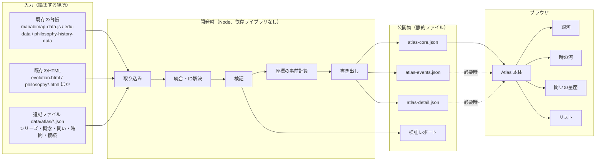
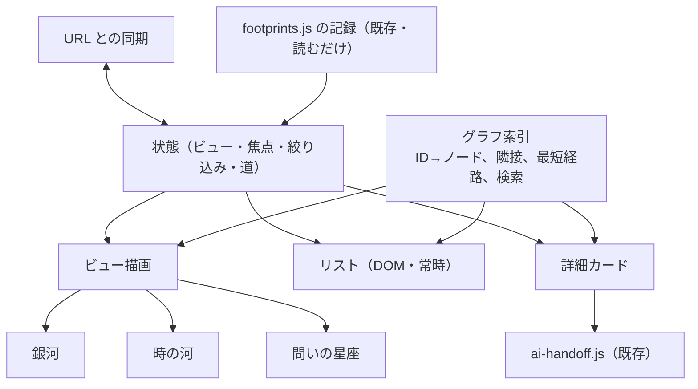

# 06. 技術設計

方針は「**既存を触らず包む**」「**サイトはビルド無しのまま、開発時だけ道具を使う**」の2つです。

## 1. 全体の流れ



## 2. ファイル構成（案）

すべて**新規の場所**に置きます。既存の `assets/js` `assets/css` と混ざらないようにします。

```
data/atlas/                 ← 人が編集する追記ファイル
  series.json               シリーズ定義
  families.json             系統（西洋哲学と東洋哲学をゆるく束ねる単位）
  works.overrides.json      作品への追記（時間・レンズ）※未作成
  concepts.json             概念辞書 ※未作成
  questions.json            問い台帳 ※未作成
  lenses.json               レンズ定義
  people.json               人物（EDU以外）
  id-registry.json          固定IDの台帳（年表の出来事など、元データにIDが無いもの）
  edges.suggested.json      横断接続の候補（公開データには入らない）
  edges.json                横断接続（why つき）
  routes.json               道
tools/atlas/                ← 開発時スクリプト（Node標準機能のみ）
  build.mjs                 取り込み→統合→検証→書き出し
  adapters/                 既存台帳ごとの読み取り
  validate.mjs              検証（エラー／編集待ち／注意）
  report.mjs                レポート生成（docs/manabimap-next/reports/atlas-report.md）
assets/atlas/               ← 公開される生成物と新UI
  data/atlas-core.json
  data/atlas-events.json
  data/atlas-detail.json
  data/atlas-index.json     IDの一覧と件数（次回ビルドとの比較用）
  js/atlas-*.js
  css/atlas.css
atlas.html                  ← 新ビューのページ（検証期間中は noindex・未リンク）
docs/manabimap-next/        ← 本設計資料
```

生成物（`assets/atlas/data/*.json`）は**リポジトリにコミット**します。GitHub Pages がそのまま配信でき、
公開側にビルド工程が要らないためです。

## 3. 取り込み（アダプタ）

既存の台帳を**読むだけ**で、書き換えません。今回の調査で実際に使った方法をそのまま道具にします。

| 対象 | 読み方 | 注意点 |
|---|---|---|
| `manabimap-data.js` | Node の `vm` で実行し `window.ManabiMapData` を取り出す | 調査で動作確認済み。DOM不要 |
| `edu-data/*.js` | 同上（6ファイル） | 調査で動作確認済み |
| `philosophy-history-data.js` | 同上 | 同上 |
| `manabimap-en.js` | 同上 | 英語の題・問い |
| `partNN-page.js` | 同上（`PartPageConfig`） | 話・前後の部・年表 |
| `evolution.html` | HTMLを文字列として読み、`.event` 要素から日付・題・説明・リンク・時代区分を抽出 | 現行の実行時抽出と同じ規則。`EVENT_LENSES` と `CURATED_ADDITIONS` は `evolution-deep-time.js` から取り出す |
| `evolution-philosophy.js` | `points` 配列を取り出す | 24件、日英あり |
| `parts/philosophy*.html` ほか8本 | 題・話の見出し・人物と生没年を抽出 | 抽出が不安定な項目は `works.overrides.json` に手入力 |

- `knowledge-galaxy.js` 内の英訳表やレンズ判定の正規表現は、**初回だけ結果を出力して追記ファイルに固定**し、以後は参照しません。
- アダプタが読めない形に既存ファイルが変わった場合、ビルドは失敗して知らせます（黙って件数が減ることを防ぐ）。

## 4. 生成データの形と分割

| ファイル | 中身 | 読み込み | 目安サイズ |
|---|---|---|---|
| `atlas-core.json` | シリーズ・作品・概念・問い・レンズ・人物・道・それらのエッジ・座標 | 最初に必ず | 圧縮後 60KB 以下 |
| `atlas-events.json` | 出来事とそのエッジ | 時の河を開いたとき／近景に入ったとき | 圧縮後 80KB 以下 |
| `atlas-detail.json` | 話・note・Podcast・動画・研究カード | 近景に入ったとき／カードで必要になったとき | 圧縮後 60KB 以下 |

参考：現行の `manabimap-data.js` は非圧縮で292KBあり、銀河の表示に不要な note の本文抜粋まで含めて毎回読み込んでいます。
分割により、最初の表示に必要なデータは現行より小さくなります。

形式は、ノードの配列とエッジの配列という単純な形にします。

```jsonc
{
  "version": "2026-11-15.1",
  "generated": "2026-11-15T09:00:00Z",
  "nodes": [ { "id": "work:part17", "type": "work", ... } ],
  "edges": [ { "from": "work:philosophy1", "to": "work:part5", "type": "bridges", ... } ],
  "layout": { "galaxy": { "work:part17": [0.62, 0.41] } }
}
```

実測（2026-11-15、圧縮後）：core 26KB、events 75KB、detail 53KB。いずれも目安の範囲内です。

`file://` で直接開いたときは JSON の読み込みが制限されるため、同じ内容を `window.ManabiAtlasData = …` として
包んだ `.js` も併せて出力します（現行の「グローバルに置く」方式との互換）。

## 5. ブラウザ側の構成



- **言語**：素のJavaScript。フレームワークなし。新規コードは ES Modules（`<script type="module">`）で書き、既存の即時関数＋グローバル方式とは独立させます。GitHub Pages でそのまま動きます。
- **状態は1か所**：ビュー・焦点・絞り込み・道を1つのオブジェクトで持ち、変更を各ビューとカードに通知。ビュー同士は互いを知りません（＝新しいビューを後から足せる）。
- **URL**：`atlas.html?view=galaxy&focus=work:part5&lens=information&path=part3,part8,part5`。`history.pushState` で戻る・進むに対応。現行の銀河には無い機能です。
- **描画**：前景は Canvas 2D（現行の銀河と同じ）。背景の星は現行の WebGL をそのまま流用。線・ラベル・星は「視界に入っているもの」「現在の深さで見せるもの」だけ描きます。
- **リスト**：canvas と同じノードを DOM に常に持ち、フォーカスと読み上げを担当（[05](05-exploration-ui.md) の9）。
- **検索**：題・別名・人物名・概念名の前方一致＋部分一致。数百件規模なので索引ライブラリは不要です。
- **最短経路**：エッジは数千本以下なので、幅優先探索で即時に求まります。

### 座標は事前に計算する

銀河の配置は開発時に計算して `layout` に保存し、ブラウザでは計算しません。

1. 既存のシリーズ・作品の座標は固定する（本編は現行の渦状腕を維持）。
2. 新しいシリーズの星団の中心は、**既存作品との近さから自動で決める**。そのシリーズの作品が、橋・概念・問いを多く共有する既存作品の方角に、空いている場所を探して置く。同じ系統（family）のシリーズは隣に寄せる。
3. シリーズ内では、概念・問いの共有が多い作品を近くに置く（力学的な配置を**開発時に**収束させる）。
4. 結果が気に入らなければ、人が星団の中心だけ上書きできる（`series.json` に座標を書く）。
5. 一度公開した座標は動かさない（追加で既存の星が動かない）。

シリーズが興味に応じて雑多に増える前提のため、分野ごとの空き枠は事前に用意しません。
銀河は外側へ広がっていく形になり、遠景ではそのぶん引いて見せます（最大でシリーズ30程度までを想定）。

これにより、表示が速く、端末による差が出ず、地図として覚えられます。

## 6. 性能の設計

対象規模（3年後の想定上限）：作品200、出来事1,000、概念300、問い300、メディア2,000、エッジ8,000。

| 項目 | 目標 | 手段 |
|---|---|---|
| 最初の表示に必要なデータ | 圧縮後 60KB 以下 | 3分割、メディアは後読み |
| 操作可能になるまで（4G・中位スマホ） | 2.5秒以内 | 座標は事前計算、DOMリストは作品のみ先行 |
| 描画 | PC 60fps／スマホ 30fps以上 | 視界外・深さ外は描かない。ラベルは焦点付近のみ |
| 同時に描く線 | 12本以下（既定） | 焦点の接続のみ |
| メモリ | 前景は150MB以下 | 画像はカード表示時に読み込み |
| 静止時の負荷 | 動きが無ければ描画を止める | 現行の「画面外・非表示タブで停止」を踏襲し、静止時も停止 |

現行の背景は80万点（スマホ40万点）のWebGL描画で、ここが最も重い箇所です。Atlasでは据え置きとし、
低スペック端末の判定（描画時間の実測）で点数を自動的に減らす仕組みを足します。

## 7. 既存ページとの共存と移行

| 段階 | 既存ファイルへの変更 | 内容 |
|---|---|---|
| フェーズ1–2 | **なし** | 新規ファイルの追加のみ。`atlas.html` は未リンク |
| フェーズ3 | `index.html`、`knowledge-galaxy.js`、`map.html` | 銀河と一覧のデータ元を Atlas に切り替え。旧データでも動く分岐を残す |
| フェーズ4 | `evolution.html`、`evolution-deep-time.js` | 時の河のレーンを追加。出来事カードに作品への逆リンク |
| フェーズ5 | 作品ページ（共通スクリプト1本を追加） | 横断パネルを差し込む |

- **互換の窓口**：`window.ManabiMapData` は当面そのまま残します。将来、中核台帳を Atlas 側へ寄せる場合も、同じ形のオブジェクトを Atlas から生成して差し替えれば、依存する約30ページは無変更で済みます。
- **作品ページへの差し込み**：世代の違う4種のページに共通で入れられるよう、「`<script>` 1本を足すと、ページ末尾に横断パネルが現れる」方式にします。本文のHTML構造には依存しません。ページ→作品IDの対応は現行 `part-connector.js` と同じくファイル名から求めます。
- **切り戻し**：各フェーズの変更は、データ元の切替を1か所の設定で元に戻せるようにします。

## 8. 多言語

- 文字列は `{ja, en}`。表示言語は現行どおり `<html lang>` で判定。
- 英語の無いノードは日本語で表示し、検証レポートに「未翻訳」として計上。
- 年表は現在、日英で別HTML（各160件）を持っています。出来事をデータ化すれば、将来1つのデータから両言語を生成できます（今回の範囲では生成までは行わず、IDの対応づけにとどめます）。

## 9. 計測とプライバシー

- 現行の `cta-tracking.js`（`data-track-*` 属性 → GA4）をそのまま使い、Atlas の操作に属性を付けます。
- 送るのは操作の種類とノードIDのみ。個人を識別する情報や、たどった道の全体は送りません。
- 足あとは現行どおり端末内（localStorage）のみ。

| イベント | 意味 |
|---|---|
| `atlas_view_switch` | ビュー切替 |
| `atlas_focus` | ノード選択（種類・ID） |
| `atlas_bridge_follow` | シリーズ横断の接続をたどった |
| `atlas_open_page` | 既存ページを開いた |
| `atlas_path_find` | 「2つをつなぐ」を使った |
| `atlas_ai_handoff` | AIへ渡した |

## 10. 開発環境と自動検証

- 必要なもの：Node（現行のLTS）。外部ライブラリは使いません。`package.json` はスクリプト名の定義のみ。
- 実行：

```bash
node tools/atlas/build.mjs
```

```bash
node tools/atlas/build.mjs --check
```

- **自動検証（提案）**：GitHub Actions でプルリクエストごとに検証を走らせ、参照切れ・必須項目の欠落・生成物の更新漏れを知らせます。公開（Pages）の流れは変えません。導入するかは [09](09-open-questions.md) で確認させてください。

## 11. 技術選定の理由

| 選択 | 採らなかった案 | 理由 |
|---|---|---|
| 素のJS＋ES Modules | フレームワーク | 既存がビルド無し。保守する依存を増やさない |
| Canvas 2D（前景） | SVG／3Dライブラリ | 現行銀河と同じ。数百ノードで十分速い。3D操作は学習UIとして採らない（[03](03-options.md)） |
| 静的JSON | データベース／CMS | GitHub Pages でそのまま配信。差分がプルリクエストで読める |
| 座標の事前計算 | 実行時の力学レイアウト | 位置が毎回同じ。端末負荷が無い |
| 追記ファイルで拡張 | 既存台帳を直接改造 | 約30ページが依存する中核を初期段階で触らない |
| Node標準機能のみ | ビルドツール | 道具の更新に追われない |
