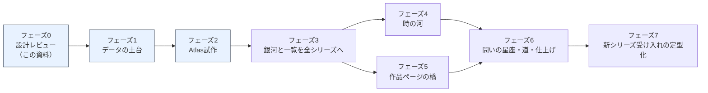

# 08. 実装計画

小さく区切り、各フェーズの終わりで「続ける／止める／方向を変える」を判断できるようにします。
期間はあえて書かず、**作業量の目安（小・中・大）と順序**で示します。実際の日程は体制が決まってから置いてください。

## 全体の流れ

色つき（0〜2）は**本番に影響しない**フェーズです。

| フェーズ | 既存ファイルの変更 | 公開サイトの見た目 | 作業量 |
|---|---|---|---|
| 0 設計レビュー | なし | 変わらない | — |
| 1 データの土台 | なし（追加のみ） | 変わらない | 中 |
| 2 Atlas試作 | なし（追加のみ） | 変わらない（未リンクの新ページ） | 大 |
| 3 銀河と一覧 | あり（3ファイル） | トップと地図に全シリーズが現れる | 中 |
| 4 時の河 | あり（2ファイル） | 年表にシリーズの流れが加わる | 中 |
| 5 作品ページの橋 | あり（共通スクリプト追加） | 作品ページに横断パネル | 中 |
| 6 問いの星座・道 | 小 | 新ビューを正式公開 | 中 |
| 7 定型化 | なし | — | 小 |

---

## フェーズ0：設計レビュー（いまここ）

- **成果物**：本資料（`docs/manabimap-next/`）。
- **決めること**：[09 未決事項](09-open-questions.md) の各項目。特に、採用案・レンズの統合・大きな問いの決め方。
- **完了条件**：案Bで進める合意、未決事項のうち「フェーズ1開始前に必要」と記した項目の回答。

## フェーズ1：データの土台

> **進捗（2026-11-15）**：フェーズ1は一通り完了。`node tools/atlas/build.mjs` でエラー0件、編集待ち100件（内訳は下記）。
> 編集判断は一任を受けて下書きを作成済みで、内容の確認だけが残っています。最新の数値は [reports/atlas-report.md](reports/atlas-report.md)。
>
> | # | 状態 | 補足 |
> |---|---|---|
> | 1-1 取り込み | 済 | 5系統すべて。本編の「話」のみ未取り込み |
> | 1-2 現状レポート | 済 | ビルドのたびに自動更新 |
> | 1-3 シリーズ定義 | 済 | 公開中5＋構想6（科学・宇宙・物理・生命・AIの源流・おはなし おはなし）、41作品 |
> | 1-4 年表の固定ID・時間の数値化 | 済 | 年表184件中183件を数値化（残り1件は未来の「?」） |
> | 1-5 概念辞書 | 済（下書き） | 39語。うち38語が2作品以上、36語が2シリーズ以上にまたがる。1作品にしか出ない既存の語は作品のキーワードへ |
> | 1-6 問い台帳 | 済（下書き） | 大きな問い13。作品の問い107件すべてに親を設定 |
> | 1-7 レンズ | 済 | 13レンズ（「哲学・思想」は現行どおり独立） |
> | 1-8 作品の時間範囲 | 済（本編は下書き） | 41作品すべて。本編21作品は題材からの概算 |
> | 1-9 横断接続 | 済（確認待ち） | 理由つきの橋38本。41作品中40作品が別シリーズへ直接つながる。第16部のみ未接続（物理シリーズ待ち） |
> | 1-10 検証・生成物 | 済 | エラー／編集待ち／注意の3段階 |
>
> 編集待ち100件の内訳：橋の内容確認38、本編の時間範囲の確認21、英語の題なし20、年の読めない出来事20（「50代」「晩年」など）、橋のない作品1。

UIには一切触らず、グラフを作って検証できる状態にします。**ここで止めても価値が残る**フェーズです。

| # | 作業 | 成果物 |
|---|---|---|
| 1-1 | 取り込みスクリプト（既存台帳5系統＋HTML） | `tools/atlas/adapters/` |
| 1-2 | 現状レポートの自動出力 | 参照切れ・未定義・孤立の一覧（[07](07-validation.md) の出発点の再現） |
| 1-3 | シリーズ定義、台帳外8作品の登録 | `series.json`、`works.overrides.json` |
| 1-4 | 年表160件に固定IDと数値の時間を付与 | `events.overrides.json` |
| 1-5 | 概念辞書（73スラッグ＋101タグの整理） | `concepts.json` |
| 1-6 | 問い台帳（大きな問い＋作品の問いの親子づけ） | `questions.json` |
| 1-7 | レンズ統合と所属の固定 | `lenses.json` |
| 1-8 | 41作品の時間範囲の入力 | `works.overrides.json` |
| 1-9 | 横断接続の候補出し → 採否と理由文 | `edges.json`（40本以上） |
| 1-10 | 検証スクリプトと生成物 | `validate.mjs`、`atlas-*.json` |

- **人の判断が要る作業**：1-5、1-6、1-8、1-9（編集作業）。スクリプトは候補と下書きを出します。
- **完了条件**：自動検証エラー0件。[07](07-validation.md) 1章の「フェーズ1の目標」をすべて満たす。既存ファイルの差分なし。
- **判断ポイント**：横断接続の理由文を書く作業量が現実的か。重すぎる場合は、対象を「作品間」に絞り、出来事・人物の接続は後回しにします。

## フェーズ2：Atlas試作

> **進捗（2026-11-15）**：試作 `atlas.html` を実装済み（検索エンジン除外・サイト内からのリンクなし）。2-1〜2-7 は一通り動作し、
> 自動の動作テスト23項目（`tools/atlas/tests/atlas.e2e.cjs`）に合格。**2-8 の利用テスト（人に使ってもらう検証）は未実施**です。
>
> | # | 状態 | 補足 |
> |---|---|---|
> | 2-1 状態管理・URL同期・グラフ索引 | 済 | ビュー・焦点・レンズ・道がURLに残り、戻る／進むが効く |
> | 2-2 リスト表示と詳細カード | 済 | 作品・出来事・問い・概念・人物・シリーズ・話のカード |
> | 2-3 銀河 | 済 | 3段階の深さ、固定座標、橋の線、構想中シリーズの輪郭、足あとの表示 |
> | 2-4 時の河 | 済 | 対数軸、シリーズごとの流れ（開閉）、同じ頃の強調、哲学史・教育史 |
> | 2-5 問いの星座 | 済 | 中心の入れ替え、時代順の並べ替え |
> | 2-6 検索・2つをつなぐ・AI・足あと | 済 | AIへの受け渡しは既存の `ai-handoff.js` を利用 |
> | 2-7 キーボード・読み上げ・動きを減らす | 済（機械確認のみ） | 矢印キーでの移動、選択の読み上げ通知、リスト表示。実際の読み上げソフトでは未確認 |
> | 2-8 利用テスト | 未 | 初見の方に使ってもらう検証が必要 |
>
> 設計との差分：背景の星は既存のWebGLを流用せず、軽い2D描画にしました。水増しデータでの性能確認、英語表示、`file://` で直接開く場合の対応は未実施です。

新ページ `atlas.html`（検索エンジン除外・サイト内リンクなし）に、3ビューの骨格を作ります。

| # | 作業 |
|---|---|
| 2-1 | 状態管理・URL同期・グラフ索引 |
| 2-2 | リスト表示（DOM）と詳細カード ← **最初に作る**。これだけで全機能が使える状態にする |
| 2-3 | 銀河ビュー（3段階の深さ、固定配置、接続線） |
| 2-4 | 時の河ビュー（対数軸、シリーズの流れ、同時代の表示） |
| 2-5 | 問いの星座ビュー（最小限：中心の問いと周囲のノード） |
| 2-6 | 検索、「2つをつなぐ」、AIへの受け渡し、足あとの表示 |
| 2-7 | キーボード操作・読み上げ・動きを減らす設定 |
| 2-8 | 利用テスト（[07](07-validation.md) 4.1） |

- **作る順の理由**：リストとカードを先に作ると、canvas の出来に関係なくデータと導線を検証でき、アクセシビリティも後付けになりません。
- **完了条件**：課題シナリオの合格。性能基準（水増しデータ含む）の合格。既存ファイルの差分なし。
- **判断ポイント**：3ビューのうち、利用テストで価値が確認できなかったものは、フェーズ6で作り込まず簡素なまま残すか、外します。

## フェーズ3：銀河と一覧を全シリーズへ（最初の本番反映）

- `index.html` の銀河を、Atlasのデータで全41作品に。遠景（シリーズ単位）から始まる表示に。
- `map.html` の手書きカード（哲学・東洋哲学・数学の9枚）を自動生成に置き換え、EDUも同じ一覧に。
- 銀河のキーボード操作と裏のリストを追加。状態をURLに。
- 英語版トップ（`en/index.html`）は、英語のある作品のみ表示（現行同等）。

| | |
|---|---|
| 変更する既存ファイル | `index.html`、`assets/js/knowledge-galaxy.js`、`map.html`（＋英語版の対応箇所） |
| 切り戻し | データ元の切替を1か所で戻せる形にしておく |
| 完了条件 | [07](07-validation.md) 7章の回帰確認に合格。既存21作品の表示が意図どおり |
| 事前準備 | 導入前の計測値（シリーズ横断率など）を記録 |

## フェーズ4：時の河

- `evolution.html` 上部の時間軸に、シリーズの流れ（レーン）を重ねる。
- 出来事カードに「この出来事を扱う作品」を表示（既存の49リンクを、データから両方向に）。
- 哲学史・教育史の出来事を、選択式で同じ軸に重ねられるようにする。
- 縦スクロールの読み物部分は変更しません。

| | |
|---|---|
| 変更する既存ファイル | `evolution.html`（最小限の差し込み口）、`assets/js/evolution-deep-time.js` |
| 完了条件 | 出来事184件の表示が導入前と一致。教育史51件が最大ズームで選べる |
| 注意 | 年表は実行時にDOMを読む構造で、読み込み順に依存しています。変更は最も慎重に |

## フェーズ5：作品ページの橋

- 全シリーズの作品ページ共通の横断パネル（次の部＋別シリーズへの橋＋同じ頃の出来事）。
- 本編は既存の「学びの地図の現在地」パネルの**下に追加**する形から始め、置き換えは後で判断。
- 哲学・数学・EDUの作品ページにも同じパネルが出る（現在は横断導線が無い）。

| | |
|---|---|
| 変更する既存ファイル | 各作品ページに `<script>` を1行追加（44＋英語21ファイル）。本文は変更なし |
| 完了条件 | 4世代それぞれの作品ページで表示が崩れない。パネルからの遷移が計測できる |
| 進め方 | まず哲学1と第5部の2ページで試し、問題がなければ全体へ |

フェーズ4と5は互いに独立で、順番を入れ替えたり並行したりできます。
**利用者への効果が早く出るのはフェーズ5**（作品を読み終えた人に次の橋を渡せるため）です。

## フェーズ6：問いの星座・道・仕上げ

- 問いの星座を作り込み、`questions.html` から入れるように。
- シリーズをまたぐ「道」を3〜5本用意（既存6本に追加）。自分の道の共有（URL）。
- `atlas.html` を正式公開（ナビゲーションに追加、検索エンジン除外を解除）。
- 英語対応の拡充。

## フェーズ7：新シリーズ受け入れの定型化

科学・宇宙・物理・生命・AIの源流など、興味に応じて増えるシリーズを迎える準備です。分野を予測しない前提で作ります。

- 「新シリーズ追加の手順書」とひな形（シリーズ定義、作品の必須項目、最初に書く横断接続3本）。作品1本だけのシリーズ、シリーズに属さない単発作品にも対応。
- シリーズの分割・統合・改名の手順（例：「科学」から「宇宙」を独立させる）。
- 追加時の自動検証（必須項目・到達性）。
- **完了条件**：手順書だけを見て、既存と分野の離れたシリーズ（作品1〜4本）を追加し、置き場所を人が指定しなくても3ビューすべてに現れること（[02](02-vision.md) の成功の定義3）。

---

## リスクと対応

| リスク | 起きやすさ | 影響 | 対応 |
|---|---|---|---|
| 接続の理由文・概念辞書の編集作業が滞る | 高 | フェーズ1が終わらない | 範囲を作品間40本に絞る。候補と下書きを自動で出す。完璧を待たず「公開可」のものから出す |
| 既存台帳が並行して更新され、取り込みがずれる | 中 | 件数不一致 | アダプタは読むだけ。件数急減はエラーで停止。新作追加時は追記ファイルも同じプルリクエストで |
| 年表のDOM依存を崩して表示が乱れる | 中 | 主要ページの不具合 | フェーズ4は差し込み口を最小限に。前後の画面比較を必須に |
| シリーズが雑多に増え、銀河がまとまりを失う | 中 | 全体像が読めない | 系統でゆるく囲む。位置はつながりから自動決定。新作に橋1本以上を必須に。シリーズ30・作品200の水増しデータで事前確認 |
| 銀河が作品増で読みにくくなる | 中 | 中心的体験の劣化 | 遠景はシリーズ単位。線は焦点のみ。水増しデータで事前確認 |
| 新ビューが使われない | 中 | 投資が無駄になる | フェーズ2の利用テストで判断。価値の出たビューから本番へ |
| 低スペック端末で重い | 中 | 離脱 | リスト表示を常に用意。背景の星を自動で間引く |
| 接続の内容に誤り（歴史・思想） | 低〜中 | 信頼の毀損 | 人の確認を必須に。出典のある接続を優先。誤り報告の窓口を用意 |
| 既存URL・検索順位への影響 | 低 | 流入減 | URLは変えない。新ページは検証完了まで検索エンジン除外 |

## 新シリーズを足すときの流れ（完成後のイメージ）

1. 作品ページを作る（従来どおり、どの世代の作り方でもよい）。
2. `series.json` にシリーズを1件、`works.overrides.json` に作品を追記（題・URL・時間・問い・概念・レンズ）。
3. 既存作品への橋を最低3本、理由つきで `edges.json` に書く。
4. 検証を実行。エラー0件なら生成物を更新。
5. プルリクエスト。銀河・時の河・問いの星座・一覧・作品ページのパネルに自動で現れる。

現在は、同じことをするのに `map.html` の手書きカード、各作品ページの相互リンク、（載せるなら）銀河用データと英訳表の4か所を個別に編集する必要があります。

## すぐ着手できる最初の一歩

合意が得られた場合、最初のプルリクエストは次の3点に絞ることを提案します（いずれも既存ファイルの変更なし）。

1. 取り込みスクリプトと現状レポート（1-1、1-2）。
2. シリーズ定義と台帳外8作品の登録（1-3）。
3. 年表160件の固定ID付与（1-4）。

これだけで「41作品・267出来事が1つのグラフに載った」状態になり、以降の編集作業（概念・問い・接続）の土台ができます。
